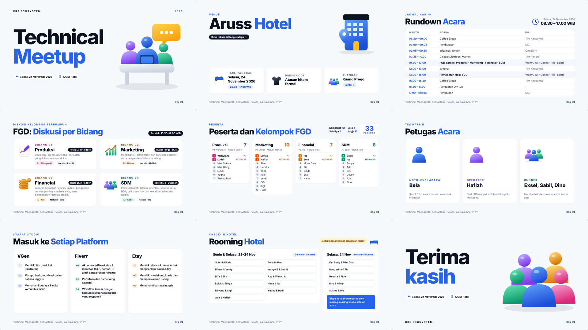

# crs-technical-meetup

Plugin untuk membuat **deck informasi acara** 16:9 dengan branding CRS Ecosystem, berdasarkan desain deck *Technical Meetup CRS Ecosystem* (November 2026).



## Isi

Skill `deck-technical-meetup` dengan 9 tata letak slide:

| Tipe | Kegunaan |
|---|---|
| `cover` | Judul acara, tanggal, tempat |
| `venue` | Lokasi, tombol Google Maps, tanggal & jam, dress code, ruangan |
| `rundown` | Tabel jadwal Waktu · Acara · PIC |
| `bidang` | Kartu FGD per bidang (lokasi, deskripsi, PJ, notulis) |
| `peserta` | Daftar anggota per kelompok + rekap asal kota |
| `petugas` | Peran tim hari-H |
| `daftar` | Kolom poin bernomor (syarat, aturan, checklist) |
| `rooming` | Pembagian kamar hotel |
| `penutup` | Terima kasih |

## Cara pakai

Minta Claude, misalnya: *"buatkan deck informasi umum untuk Technical Meetup bulan depan"*.

Atau jalankan manual:

```bash
cd skills/deck-technical-meetup
python3 scripts/build_deck.py examples/technical-meetup-nov-2026.json deck.html
```

Struktur data lengkap ada di `skills/deck-technical-meetup/references/schema.md`.

## Struktur

```
.claude-plugin/plugin.json
skills/deck-technical-meetup/
  SKILL.md
  scripts/build_deck.py
  references/{deck.css, tokens.json, schema.md}
  examples/technical-meetup-nov-2026.json
```
